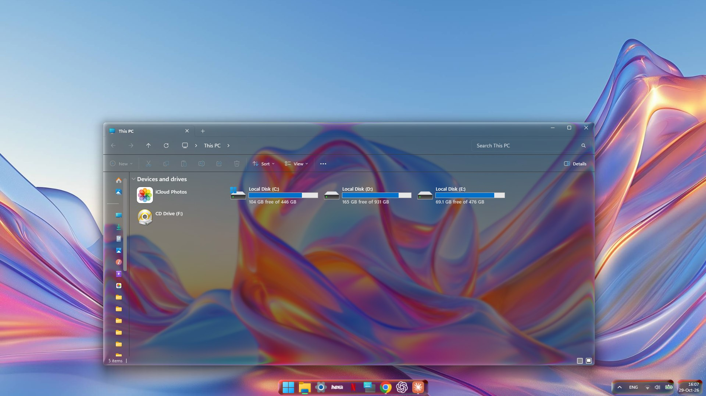
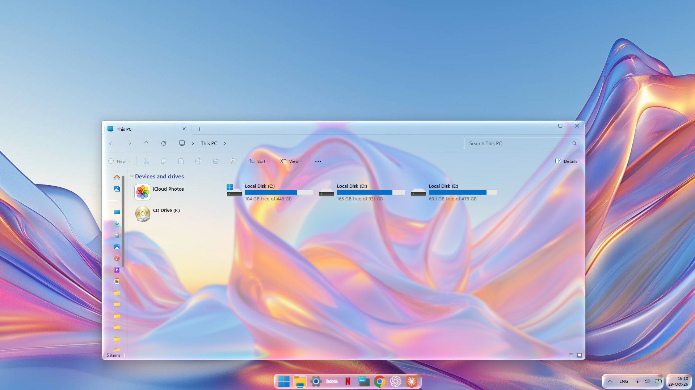

# Open Fluid Glass

Open Fluid Glass adds real refraction to Windows. Glass bends what is behind it, like a lens, instead of only blurring it, with low resource consumption. It is a fork of [OpenGlass](https://github.com/ALTaleX531/OpenGlass) by [ALTaleX](https://github.com/ALTaleX531). OpenGlass hooks into DWM and draws the glass in window frames, and this fork adds the refraction to it. File Explorer turns to glass through the bundled [ExplorerBlurMica](https://github.com/Maplespe/ExplorerBlurMica) by Maplespe. The fork brings the refraction there too, and to the taskbar, Start and Search.

This is an independent project. It is not made, endorsed or supported by the OpenGlass author, by Microsoft or by Apple. Please report problems with this fork here, not to OpenGlass.

| Dark mode | Light mode |
| --- | --- |
|  |  |

## What it adds to OpenGlass

- **Fluid Glass.** A refraction pass in the Direct3D glass shader. You control the bezel, thickness, index of refraction, chromatic edge, clarity, softness, rim light, shine and light angle. Text readability has separate light and dark mode values. The tint of each window follows that window's own light or dark mode.
- **Floating taskbar.** The Windows 11 taskbar becomes separate glass pills. You can set their height, padding, gap, icon size and corner radius, or join them into one bar.
- **Start and Search.** Their acrylic is replaced with Fluid Glass that follows the open and close slides.
- **File Explorer.** The content area turns to glass through the bundled [ExplorerBlurMica](https://github.com/Maplespe/ExplorerBlurMica). Hover, selection and tooltips get glass highlights. The same can be turned on for the Open and Save dialogs of other apps.
- **A redesigned settings app** with a tab for each of the above and named presets.

## Supported Windows versions

| Windows version (OS build) | Status |
| --- | --- |
| Windows 11 25H2 (26200) | Tested |
| Windows 11 26H2 (26300) | Tested |
| Other builds that OpenGlass supports | Not tested |

Fluid Glass needs the Legacy DWM architecture, which covers builds below 28000. On Windows 11 26H1 (28000) you get plain OpenGlass. The taskbar, Start and Search glass need Windows 11. Insider builds are not supported.

## Install

1. Download `OpenFluidGlassSetup.exe` from [Releases](../../releases).
2. If OpenGlass is installed, uninstall it first. The two cannot run together, and the setup stops if it finds OpenGlass.
3. Run the setup. It needs administrator rights. On the last page you can restart Explorer and start the taskbar.
4. Open **Open Fluid Glass** from the Start menu to adjust the look. Sliders apply at once.

The setup ships a tuned look as the machine default. Whatever you change in the settings app is saved for your own account and takes priority.

> [!TIP]
> **Emergency exit:** hold <kbd>Ctrl</kbd>+<kbd>Win</kbd>+<kbd>Shift</kbd>+<kbd>Q</kbd> to stop DWM if the screen stops responding. Windows starts it again on its own.

### Windows SmartScreen and antivirus

The files are not code signed yet. Windows SmartScreen may show "Windows protected your PC" and an unknown publisher. Choose **More info** and then **Run anyway** if you trust this build. You can also build it yourself from this source.

Some antivirus products may flag the taskbar module. To draw glass behind the taskbar, Start and Search, Open Fluid Glass loads its own code into Explorer and the Start menu host. This is the same method that [TranslucentTB](https://github.com/TranslucentTB/TranslucentTB) uses.

## Privacy

Open Fluid Glass has no telemetry, no analytics and no accounts. It does not write log files. It never records what you type. The only keys it checks are the emergency exit combination above, plus <kbd>Shift</kbd> when you open the **More** menu of the settings app. It looks at window positions and sizes only to place the glass.

It connects to the internet for one thing only. It downloads public debug symbols for the Windows DWM files (such as `uDWM.dll`) from Microsoft's symbol server (`msdl.microsoft.com`). These tell OpenGlass where to hook into DWM on your Windows build. Nothing about you or your PC is sent, apart from what any download from Microsoft involves.

What it changes on your PC:

- A Windows service that loads the glass into DWM, as OpenGlass does.
- Settings in `Software\Microsoft\Windows\DWM` and `Software\OpenGlass`, for the machine (`HKLM`) and for each user (`HKCU`).
- A scheduled task, `FluidGlassTaskbar`, that starts the taskbar at sign-in.
- A shell extension for ExplorerBlurMica and one for the File Explorer glass highlights.
- Copies of the taskbar modules in `%LOCALAPPDATA%\OpenGlass\tap`, because Program Files is read-only for normal users.

Uninstalling removes the service, the task and the shell extensions. It asks whether to delete your settings too.

## Support

Open Fluid Glass is free. If you enjoy it, you can [buy me a coffee on Ko-fi](https://ko-fi.com/drey85). It helps me keep up with new Windows builds.

## Building

```powershell
msbuild OpenGlass.slnx /m /restore /p:Configuration=Release /p:Platform=x64
OpenGlassTaskbar\build.cmd
```

`OpenGlassTaskbar\build.cmd` calls `vcvars64.bat` from a fixed Visual Studio Build Tools folder. Change that path to match your machine. Run `build.cmd logs` to get diagnostic logs in `%TEMP%`. Released builds never write them. The installer script is `Scripts\OpenGlass.iss` (Inno Setup 6), packed by `Scripts\OpenGlass.Packaging.proj`.

For the OpenGlass core (prerequisites, tests, DWM offsets), see [Building OpenGlass](https://github.com/ALTaleX531/OpenGlass/wiki/Building-OpenGlass) and the rest of the [OpenGlass wiki](https://github.com/ALTaleX531/OpenGlass/wiki).

## License

Open Fluid Glass is released under the GNU General Public License v3, like OpenGlass. See [LICENSE.txt](LICENSE.txt).

[ExplorerBlurMica](https://github.com/Maplespe/ExplorerBlurMica) by Maplespe is bundled unmodified, as a separate library, under the LGPL-3.0. See [ThirdParty/ExplorerBlurMica/NOTICE.txt](ThirdParty/ExplorerBlurMica/NOTICE.txt) and the full [LGPL-3.0 text](ThirdParty/ExplorerBlurMica/LICENSE-LGPL-3.0.txt).

## Credits

- [OpenGlass](https://github.com/ALTaleX531/OpenGlass) by [ALTaleX](https://github.com/ALTaleX531), the base of this project. If you enjoy the glass, consider [supporting its author on Ko-fi](https://ko-fi.com/altalex531).
- [ExplorerBlurMica](https://github.com/Maplespe/ExplorerBlurMica) by Maplespe, for the File Explorer content area.
- [TranslucentTB](https://github.com/TranslucentTB/TranslucentTB), whose XAML diagnostics approach showed how to reach the Windows 11 taskbar.
- [KNSoft.SlimDetours](https://github.com/KNSoft/KNSoft.SlimDetours), [VC-LTL](https://github.com/Chuyu-Team/VC-LTL5) and [Windows Implementation Libraries](https://github.com/Microsoft/wil).
- [libvalinet](https://github.com/valinet/libvalinet), whose symbol download work inspired OpenGlass.
- [[MS-RDPCR2]: Remote Desktop Protocol: Composited Remoting V2](https://learn.microsoft.com/en-us/openspecs/windows_protocols/ms-rdpcr2).

DWM has no official extension mechanism. A Windows update can break Open Fluid Glass at any time.
